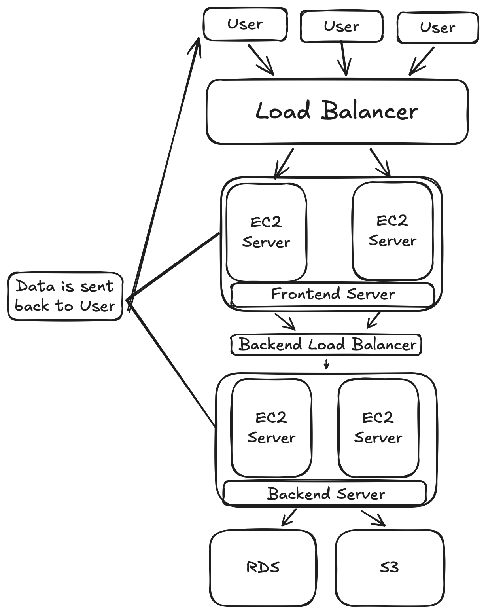

Cloud Infrastructure Design for a Web Application

Project Overview

For this project, I designed a basic cloud infrastructure for a web application using AWS services. The goal was to understand how different cloud components work together to handle website traffic, process requests, and store data.

I used Excalidraw to create an architecture diagram showing how users connect to a web application and how traffic flows between different AWS services.

This project focuses on designing the infrastructure rather than actually deploying it.

1. Architecture Components

My architecture includes the following AWS services:

Application Load Balancer (ALB)

Receives incoming traffic from users.

Distributes requests between frontend EC2 servers.

Helps prevent one server from handling all the traffic.

Frontend EC2 Servers

Handle the user-facing part of the website.

Receive traffic from the main load balancer.

Communicate with the backend servers.

I included two EC2 instances to distribute traffic.

Backend Load Balancer

Receives application requests from frontend servers.

Distributes requests between backend EC2 servers.

Helps maintain availability if one backend server fails.

Backend EC2 Servers

Handle application logic and process requests.

Communicate with the database and storage services.

I included two backend EC2 instances for better reliability.

Amazon RDS

Stores structured data such as user information and application records.

Allows backend servers to retrieve and update information.

Amazon S3

Stores files such as images, documents, and other uploaded content.

Provides scalable object storage without managing storage servers.

2. How the Architecture Works

The traffic follows this process:

Users access the web application through their browsers.

The Application Load Balancer receives incoming requests.

Traffic is distributed between two frontend EC2 servers.

The frontend servers communicate with the backend load balancer.

The backend load balancer distributes requests between two backend EC2 servers.

The backend servers communicate with Amazon RDS to store or retrieve structured data.

The backend servers use Amazon S3 to store or retrieve files.

The application sends the requested information back to the users.

3. Scaling and High Availability

For the frontend and backend EC2 servers, I chose horizontal scaling, which means adding more servers when traffic increases.

This helps distribute workloads and prevents the application from relying on only one server.

For Amazon RDS, I would initially use vertical scaling, meaning increasing the database's CPU, memory, or storage capacity as needed.

Amazon S3 automatically scales to handle growing storage requirements.

To improve high availability in the future, I would consider:

Deploying EC2 instances across multiple Availability Zones.

Using EC2 Auto Scaling to adjust the number of servers based on demand.

Configuring Amazon RDS Multi-AZ for database redundancy.

4. Security Considerations

To protect the application and its data, I would implement the following security measures:

HTTPS: Encrypts traffic between users and the application.

Security Groups: Control which network connections are allowed.

IAM Roles: Give AWS resources only the permissions they need.

Private Subnets: Keep backend servers and databases from being directly exposed to the internet.

S3 Block Public Access: Helps prevent unintended public access to stored files.

5. Performance and Cost Optimization

One important part of designing cloud infrastructure is balancing performance and cost.

Using multiple EC2 instances and load balancers helps distribute traffic and improves reliability. However, running more resources also increases AWS costs.

For a smaller application, I would start with appropriately sized instances and increase capacity as traffic grows.

I would also consider Auto Scaling to help manage resources based on demand.

The goal is to build an application that performs well without spending more than necessary.

6. What I Learned

Through this project, I learned how different AWS services work together to support a web application.

I learned how load balancers distribute traffic, why frontend and backend servers are separated, and how Amazon RDS and S3 are used for different storage needs.

I also learned the difference between horizontal and vertical scaling and why redundancy is important for keeping applications available.

Most importantly, I learned that designing cloud infrastructure requires considering security, performance, availability, and cost before deploying resources.

7. Conclusion

This project helped me better understand the fundamentals of cloud architecture and how to design infrastructure for a web application.

Although I did not deploy the infrastructure in AWS, creating the architecture diagram helped me visualize how the different components communicate with each other.

This project serves as a foundation for future hands-on AWS projects as I continue learning Cloud Engineering.
